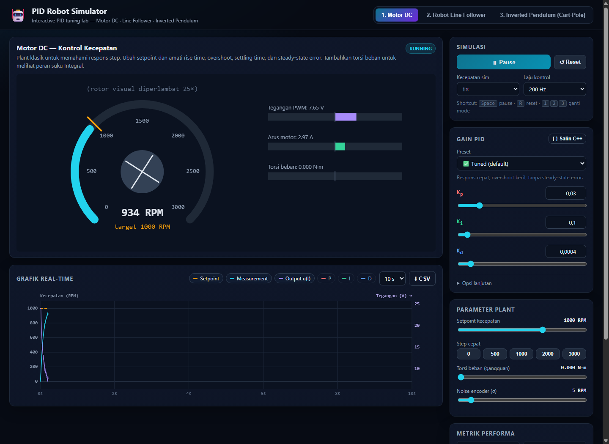
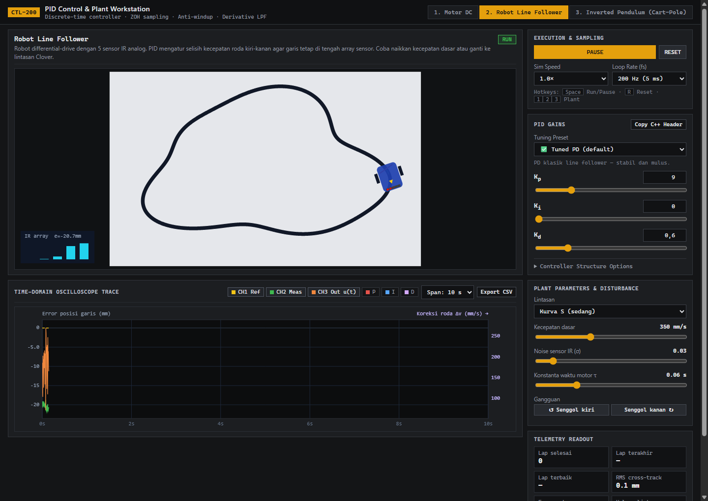
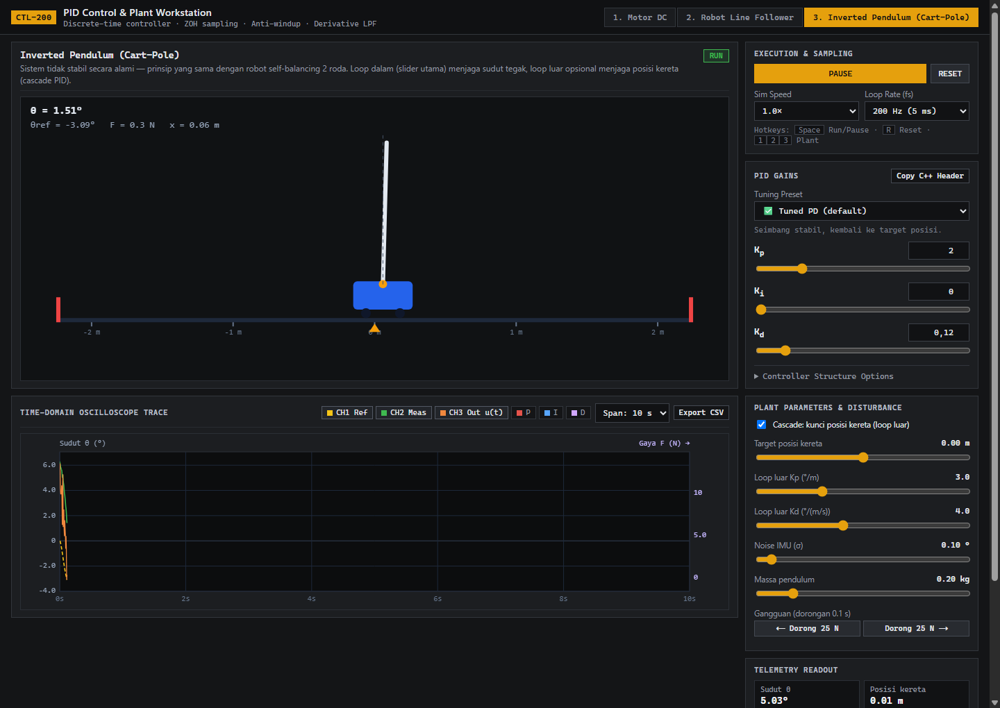
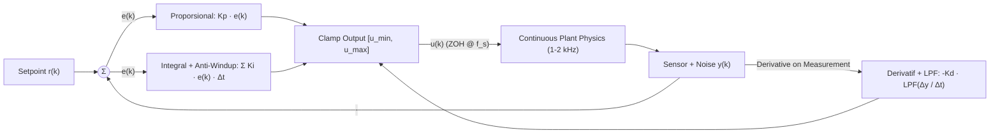

# 🤖 PID Robot Simulator & Embedded C++ Library

[](https://shofwanraditya.github.io/pid-robot-simulator/simulator/)
[](https://github.com/shofwanraditya/pid-robot-simulator/actions)
[](#struktur-repositori)
[](#2-library-firmware-c-arduino--esp32--stm32)

> **👉 Coba Simulator Langsung di Browser:** **[https://shofwanraditya.github.io/pid-robot-simulator/](https://shofwanraditya.github.io/pid-robot-simulator/simulator/)**
>
> **Interactive Discrete-Time PID Control Lab** untuk sistem robotika & *embedded systems* — dilengkapi 3 simulasi fisika *real-time* di browser (tanpa dependency eksternal) dan **library C++ portable** yang identik secara numerik untuk langsung di-flash ke Arduino / ESP32 / STM32.

---

## 📸 Preview Simulator

| 1. Motor DC — Kontrol Kecepatan | 2. Robot Line Follower (5-IR Array) | 3. Inverted Pendulum (Cart-Pole) |
| :---: | :---: | :---: |
|  |  |  |

---

## ✨ Fitur Utama

### 1. Simulator Web Interaktif (`/simulator`)
* **3 Plant Robotika Klasik:**
  1. **Motor DC Orde-2 (Elektromekanik):** Eksperimen respons *step*, *rise time*, *overshoot*, *settling time* ($\pm 2\%$), *steady-state error*, dan gangguan torsi beban.
  2. **Differential-Drive Line Follower:** Robot beroda dua dengan array 5 sensor IR analog, pemodelan dinamika motor ($\tau$), 3 pilihan lintasan (*Oval*, *Kurva S*, *Clover*), serta injeksi gangguan dorongan samping.
  3. **Inverted Pendulum (Cart-Pole):** Sistem non-linear tidak stabil dengan opsi **Cascade PID** (loop dalam menjaga sudut $\theta$, loop luar mengunci posisi kereta $x$) dan uji gangguan impuls gaya $25\text{ N}$.
* **Pemisahan Laju Fisika & Laju Kontrol Diskrit:** Fisika plant diintegrasikan pada frekuensi tinggi ($1000\text{–}2000\text{ Hz}$), sedangkan kontroler PID berjalan secara diskrit pada frekuensi sampling $f_s$ yang dapat dipilih ($20\text{ Hz}$ hingga $1000\text{ Hz}$) — merepresentasikan *timer interrupt* pada mikrokontroler.
* **Fitur PID Standar Industri:**
  * *Derivative-on-Measurement* (mencegah *derivative kick* saat *setpoint* berubah mendadak).
  * *First-Order Low-Pass Filter* pada suku derivatif ($\tau_d$) untuk meredam *noise* sensor/encoder.
  * *Anti-Windup* dengan metode *conditional integration* + *integrator clamping* saat aktuator mengalami saturasi PWM/tegangan.
* **One-Click C++ Code Generator & CSV Logger:** Tombol **`{ } Salin C++`** langsung menghasilkan potongan kode inisialisasi `PIDController` C++ sesuai nilai $K_p, K_i, K_d$ yang sedang di-*tuning*, dan tombol **`⬇ CSV`** mengekspor data telemetri untuk dianalisis di Python/MATLAB/Excel.

### 2. Library Firmware C++ (`/firmware/PIDController`)
* **Zero External Dependencies:** Ditulis dalam standar C++11 murni tanpa ketergantungan header spesifik board, sehingga kompatibel dengan **Arduino AVR, ESP32, STM32 (HAL/CubeIDE), hingga desktop C++**.
* **Numerically Identical:** Algoritma di [`PIDController.cpp`](firmware/PIDController/src/PIDController.cpp) sama persis dengan [`pid.js`](simulator/js/core/pid.js) di simulator.
* **Contoh Sketch Siap Pakai:**
  * [`LineFollower.ino`](firmware/PIDController/examples/LineFollower/LineFollower.ino) — Pembacaan 5 sensor IR *weighted average* + kontrol diferensial PWM motor kiri/kanan.
  * [`DCMotorSpeed.ino`](firmware/PIDController/examples/DCMotorSpeed/DCMotorSpeed.ino) — Pembacaan RPM dengan *quadrature encoder interrupt* + telemetri *Serial Plotter*.

---

## 🧠 Arsitektur Sistem & Persamaan Kontrol



Rumus kontrol PID diskrit dengan periode sampling $\Delta t = 1 / f_s$:

$$u_k = \text{clamp}\!\left( K_p e_k + I_k + D_k,\; u_{\min},\; u_{\max} \right)$$

dengan:
* **Proporsional:** $P_k = K_p \, e_k$, di mana $e_k = r_k - y_k$
* **Integral (Conditional Anti-Windup):** $I_k = \text{clamp}\!\left(I_{k-1} + K_i \, e_k \, \Delta t,\; u_{\min},\; u_{\max}\right)$ (integrasi ditahan apabila output sedang saturasi dan tanda $e_k$ mendorong ke arah saturasi yang sama)
* **Derivatif Terfilter pada Pengukuran:**
  $$d_{\text{raw},k} = -\frac{y_k - y_{k-1}}{\Delta t}, \qquad d_k = d_{k-1} + \frac{\Delta t}{\tau_d + \Delta t}\left(d_{\text{raw},k} - d_{k-1}\right), \qquad D_k = K_d \, d_k$$

---

## 📂 Struktur Repositori

```text
pid-robot-simulator/
├── simulator/                       # Web-based Interactive Simulator (GitHub Pages ready)
│   ├── index.html                   # Antarmuka utama
│   ├── css/style.css                # Styling dark-mode laboratorium
│   └── js/
│       ├── core/
│       │   ├── pid.js               # Implementasi PIDController diskrit
│       │   ├── runner.js            # Multi-rate scheduler (fisika vs kontrol)
│       │   ├── stepAnalyzer.js      # Kalkulator rise time, overshoot, settling time, SSE
│       │   └── utils.js             # PRNG deterministik & Gaussian noise generator
│       ├── sims/
│       │   ├── dcMotor.js           # Model motor DC orde-2 (L, R, Kt, Ke, J, b)
│       │   ├── lineFollower.js      # Kinematika differential-drive & 5 sensor IR
│       │   └── cartPole.js          # Dinamika non-linear inverted pendulum + cascade PID
│       ├── ui/chart.js              # Multi-axis real-time Canvas 2D plotter + CSV export
│       └── app.js                   # Pengendali UI, preset, & generator kode C++
├── firmware/
│   └── PIDController/               # Library Arduino / ESP32 / STM32
│       ├── library.properties
│       ├── src/
│       │   ├── PIDController.h
│       │   └── PIDController.cpp
│       ├── examples/
│       │   ├── LineFollower/LineFollower.ino
│       │   └── DCMotorSpeed/DCMotorSpeed.ino
│       └── test/test_pid.cpp        # Unit test C++ (kompilasi dengan g++)
├── tests/
│   └── run-tests.js                 # 21 automated unit & physics integration tests
└── .github/workflows/ci.yml         # GitHub Actions CI (Node.js + g++)
```

---

## 🚀 Cara Menjalankan

### A. Menjalankan Simulator di Browser
Tidak memerlukan *build step* atau instalasi paket (`npm install` tidak diperlukan).
1. Buka file [`simulator/index.html`](simulator/index.html) langsung di browser (Chrome / Edge / Firefox), **atau**
2. Jalankan local server sederhana:
   ```bash
   npx serve simulator
   ```
3. Untuk mengaktifkan **GitHub Pages**: masuk ke *Settings → Pages → Source: Deploy from a branch*, atau arahkan ke folder `/simulator`.

### B. Memasang Library di Arduino IDE / PlatformIO
* **Arduino IDE:** Salin folder `firmware/PIDController` ke dalam direktori `Documents/Arduino/libraries/`, lalu buka *File → Examples → PIDController*.
* **PlatformIO:** Salin folder `firmware/PIDController` ke dalam folder `lib/` pada project PlatformIO Anda.

---

## 🧪 Pengujian (Unit Test)

Repositori ini menyertakan **21 pengujian otomatis** yang memverifikasi algoritma PID serta kestabilan tertutup (*closed-loop*) ketiga model fisika:

```bash
# Menjalankan seluruh test suite (JavaScript + simulasi fisika)
node tests/run-tests.js

# Menjalankan unit test firmware C++ (membutuhkan g++)
g++ -std=c++11 -I firmware/PIDController/src \
  firmware/PIDController/src/PIDController.cpp \
  firmware/PIDController/test/test_pid.cpp -o test_pid && ./test_pid
```

---

## 📜 Lisensi

Didistribusikan di bawah lisensi **MIT**. Bebas digunakan untuk keperluan praktikum, riset laboratorium, maupun pengembangan robot kompetisi.
